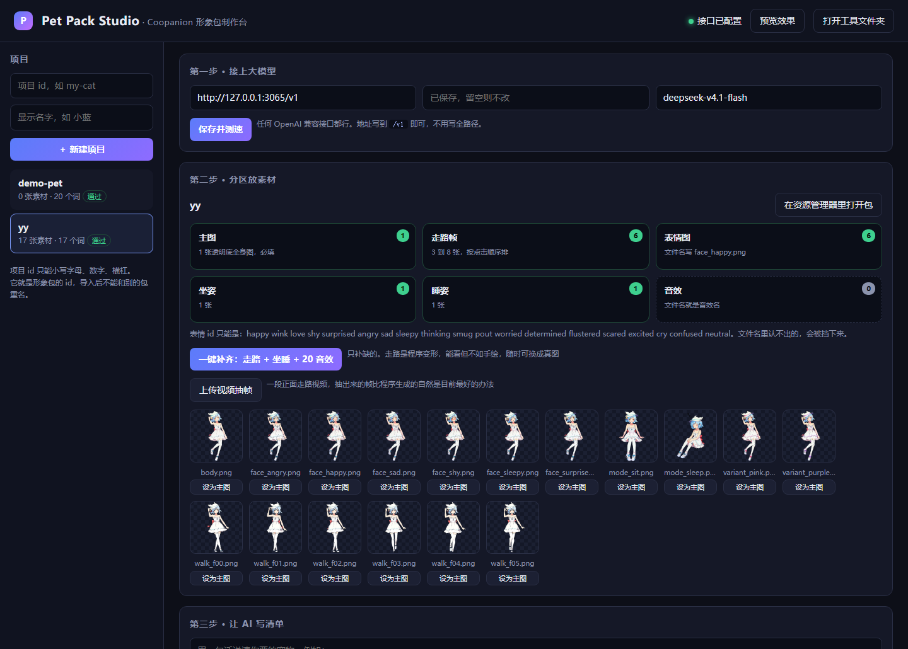

# Pet Pack Studio

**Build [Coopanion](https://github.com/Pal-AI-Lab/Coopanion) figure packs from your own art — without hand-writing `figure.json` or `figure.js`.**


[中文说明](README.zh-CN.md) · [安装](INSTALL.md) · [功能说明](docs/功能说明.md) · [格式规范](docs/02-形象包格式规范.md)

> Also mirrored on the Coopanion fork as
> [`pet-pack-studio` branch](https://github.com/qq1402094463/Coopanion/tree/pet-pack-studio/tools/pet-pack-studio),
> so it shows up next to the app itself.



---

## What it is

A figure pack is what makes Coopanion's pet look like *your* character instead of Coo.
A pack is a folder with a manifest (`figure.json`), a renderer (`figure.js`), textures and sounds.
Getting one accepted means matching a lot of rules at once: vocabulary ids, `kind` values, texture
sizes, sound names, the `draw(petG, face, frame)` contract.

Pet Pack Studio runs on your machine as a local web page.
It creates the folder structure, uploads your art into the right slots, writes the manifest —
by hand or with an LLM — validates against the real import rules, previews the pet without
installing it, and packages the result into a zip you drop into **Coopanion → Dress up → Import**.

Nothing is uploaded anywhere. The only network call is the one you configure yourself when you
want an LLM to write the manifest.

## Features

| | |
|---|---|
| **Slot-based upload** | Body / walk frames / face images / sit / sleep / sounds. Drag a file onto a card, or pick it. The tool names and resizes it correctly. |
| **One full-body image → a working pet** | Generates a 6-frame walk cycle, a sit pose, a sleep pose and 20 sound effects from one `body.png`. |
| **Face-layer expressions** | `facegen.py` redraws only the eyes and mouth region, so expressions work on every breathing frame without the body flickering. |
| **Video → walk frames** | Drop a phone clip; frames are extracted, background removed (tolerance adjustable, can be disabled), trimmed and bottom-aligned. |
| **LLM writes the manifest** | Any OpenAI-compatible `/v1` endpoint: base URL, API key, model. It returns `figure.json` with names, descriptions and `seconds`. |
| **One-click fix** | Repairs the rejections people actually hit: `about` written as a string, missing `kind`, English aliases colliding with ids, missing `about`/`seconds`, wrong `entry`/`export`. Backs up the original first. |
| **Real validation** | Same limits the importer uses: id format, reserved ids, 128 MB pack, 2048 files, 16 MB per file, 256 KB manifest, every texture and sound resolved. |
| **Preview** | Standing / walking / sitting / sleeping, 18 expressions, three backgrounds, sound audition — before you install anything. |
| **Package** | One zip, correct layout, `raw/` excluded. |

## Quick start

```bash
git clone https://github.com/qq1402094463/coopanion-pet-pack-studio.git
cd coopanion-pet-pack-studio
python -m pip install -r requirements.txt
```

Windows: double-click **`start.bat`**. macOS / Linux:

```bash
./start.sh
```

The page opens at `http://127.0.0.1:8848/` (it walks forward if the port is taken).
Close the console window to stop the server.

Then, in the page:

1. **Step 1** — paste your model endpoint, key and model name (only needed if you want the AI to write the manifest).
2. **Step 2** — create a project, drop in your `body.png`, then hit **一键补齐：走路 + 坐睡 + 20 音效** to get a complete pack from that one image.
3. **Step 3** — describe your character in one sentence and let the AI write `figure.json`. Or write it yourself.
4. **Step 4** — **检查这一包** → **打包成 zip**.
5. **预览效果** at any point to see how it moves.

In Coopanion: **Dress up → Import figure pack → pick the zip**. Same `id` again later and it asks whether to replace.

## Sample pack to download

One complete pack made with this tool is attached to the [v1.1.0 release](https://github.com/qq1402094463/coopanion-pet-pack-studio/releases/tag/v1.1.0).

| File | id | Size | Inside |
|---|---|---|---|
| [`yy-1.2.0.zip`](https://github.com/qq1402094463/coopanion-pet-pack-studio/releases/download/v1.1.0/yy-1.2.0.zip) | `yy` | 5.2 MB | 6 expressions, a 6-frame walk, sit, sleep, 20 sounds |

Download it and import it directly: **Coopanion → Import figure pack → pick the zip**. No unpacking.

Checked against the real import limits: 128 MB, 2048 files, 16 MB per file, 256 KB manifest.

## Two ways to make a pack

**A. Frame by frame (best quality).** Export one image per motion from your animation tool, drop them into the walk / sit / sleep / face slots. This is how the official figures are made.

**B. One image + generation (fastest).** Give it a single transparent `body.png`.
`autogen.py` synthesises the walk cycle (legs rotate around the hip, body counter-shifts, ground
contact squashes), the sit and sleep poses, and 20 WAV sound effects with pure Python.
`facegen.py` adds expressions by repainting the eye and mouth area.

Route B is why a single drawing can already walk, sit, sleep, blink and react.
Route A is what you want if it has to look *right* — a synthesised walk is a paper-puppet walk.

> The AI path in this tool writes manifests, not pictures. It does not generate art.
> For that, use an image model and drop the results into the slots (see [docs/07](docs/07-素材清单与生图提示词.md) for the prompts).

## Requirements

| | |
|---|---|
| Python | 3.10 or newer |
| Pillow | required — expression generation, cutout, thumbnails, bottom alignment |
| ffmpeg | optional — only for extracting frames from video |
| Node 18+ | optional — only for `studio/tools/test_pack.mjs` |

The console prints `Pillow / ffmpeg / node` on startup and the page shows a yellow banner when
something is missing. Missing Pillow does not crash the tool; features just silently degrade, so
do not ignore that banner.

## Repository layout

```
start.bat / start.sh        launchers
requirements.txt
studio/
  server.py                 HTTP server, validation, manifest fixing, packaging
  autogen.py                walk cycle / sit / sleep / 20 sound effects from one image
  facegen.py                face-layer expressions from one body image
  web/index.html            the studio page
  web/preview.html          the preview page
  templates/minimal-pack/   a valid empty pack to start from
  tools/                    placeholder generator, runtime simulation test
docs/
  00-开始读我.md             entry point (Chinese)
  01-制作流程总览.md         workflow overview
  02-形象包格式规范.md       the pack format, learned from the runtime
  03/04-AI提示词-*.md        prompts for driving an AI agent through the process
  05-测试验收清单.md         acceptance checklist
  06-常见错误对照表.md       error → cause → fix
  07-素材清单与生图提示词.md  what art to make, with image/video prompts
  08-体检报告-2026-10.md     audit of this version
  功能说明.md                every button, in detail
  开发说明.md                code map and HTTP API
images are in docs/images/
```

## Limitations

- **Synthesised walk is procedural.** Two-frame-crossed legs, not rotoscoped. For a natural gait, film a walk cycle and extract frames.
- **No AI image generation built in.** The AI step writes `figure.json` only.
- **Expressions are drawn, not painted.** `facegen.py` erases the original eyes and draws new ones on a 512 px texture. Up close it reads as a clean cartoon face, not a hand-painted one.
- **Front view only.** A figure pack cannot turn around; the runtime flips the whole group horizontally.
- **Windows is the tested platform.** The code is standard library + Pillow, so macOS/Linux should work, but that is untested.
- **Local only.** The server binds to `127.0.0.1` and rejects requests with a foreign `Host`/`Origin`.

## Contributing

Issues and pull requests are welcome — especially real walk cycles, expression sets, and reports
from macOS/Linux. See [docs/开发说明.md](docs/开发说明.md) for the code map and the HTTP API.

## License

MIT. See [LICENSE](LICENSE).

This is an independent community tool. It is not affiliated with, endorsed by, or maintained by
Pal-AI-Lab or the Coopanion project. "Coopanion" and "Coo" are referenced only to describe
compatibility with their public figure pack format. Artwork you generate with this tool belongs to
you; make sure you have the rights to the source images you import.
